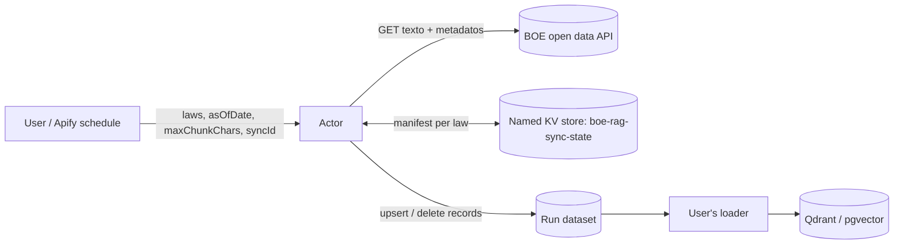

# boe-rag-sync — Design

An Apify Actor that turns Spanish consolidated legislation from the BOE into RAG-ready chunks
(one article per chunk when it fits, with its place in the law and the version in force at a date)
and keeps a vector store in sync by emitting `upsert` and `delete` records.

## Goals and non-goals

Goals:
- Chunks that respect legal structure: never cut mid-sentence when a paragraph boundary exists, always
  carry the law > title > chapter > article path.
- Correct incremental sync: the user's store never keeps an outdated or orphaned chunk.
- Zero infrastructure to operate: everything runs on Apify; no database of our own.

Non-goals (v1): case law, the daily gazette, embeddings, full-text search by law title, version history
output (`asOfDate` covers point-in-time queries).

## Source data (verified 2026-11-03)

`GET https://www.boe.es/datosabiertos/api/legislacion-consolidada/id/{id}/texto` (`Accept: application/xml`)
returns every block of a law with **all** its versions:

```xml
<bloque id="a4" tipo="precepto" titulo="Artículo 4">
  <version id_norma="BOE-A-2023-5366" fecha_publicacion="20230301" fecha_vigencia="20230302">
    <p class="articulo">Artículo 4. Derechos laborales.</p>
    <p class="parrafo">1. Los trabajadores …</p>
  </version>
</bloque>
```

Facts that shape the design:
- Hierarchy is flat: heading blocks are siblings of the articles and the path is rebuilt by level
  (`anexo` 0 > `libro` 1 > `titulo` 2 > `capitulo` 3 > `seccion` 4 > `subseccion` 5). Irregularities
  handled: heading blocks typed `Cabecera`/`Encabezado` (Penal Code); one heading block opening two levels
  (Civil Code "TÍTULO III" + its first section); lone `capitulo_num`/`capitulo_tit`; a heading typed as
  `precepto` (Penal Code "TÍTULO XIX bis").
- Dispositions (adicionales, transitorias, finales…) usually have no heading of their own, so a block titled
  "Disposición…" drops titles and chapters from the path; a "DISPOSICIONES TRANSITORIAS" heading sits at
  level 1. "Disposiciones generales" is an ordinary chapter title, not a dispositions heading.
- Block ids are not uniform even within a law (`a1` and `art2` in the Civil Code, `as127a130`); opaque.
- A repealed block keeps a last version with only its heading and a marker ("(Suprimido).", "(Derogada)",
  "(Sin contenido)", "(Anulado)"); a live article may still say "b) (Suprimida)." for one letter.
- Editorial notes are `p.nota_pie*` and every `blockquote` with a `class` (`soloTexto`, `noDesdeYYYYMMDD`,
  `siempreSeVe`…). They often quote the previous wording ("Redacción anterior"), so they are excluded from
  `text`; classless blockquotes hold quoted legal text and are kept as Markdown quotes.
- A version without `fecha_vigencia` never took effect (Civil Code art. 56, 2015) and is ignored.
- A non-existent law id returns HTTP 400.
- Versions are not in date order (8 of 4,095 blocks in five laws), and a later norm can take effect
  before an earlier one's deferred date. The wording in force at a date is, among the versions already
  in force, the one from the **most recently published** norm (lex posterior); full ties go to document
  order. This matches boe.es: income tax art. 7 has a norm published Oct 3 effective Oct 23 and one
  published Oct 7 effective Oct 8, and boe.es shows the latter. Picking the highest `fecha_vigencia`
  would serve the wrong text. Workers' Statute art. 37 has two versions effective the same day; the
  later-published one wins.
- The API does not say when a version was added to the consolidated text, so the state of a past run
  cannot be rebuilt from today's XML (see ADR 0002).
- Sizes: 1.4–3.7 MB per law; the income tax law has articles up to 56k characters and 86 tables.

## Architecture



Functional core, imperative shell: everything except the HTTP fetch and `main.py` is a pure function,
tested against real BOE XML fixtures.

| Module | Responsibility |
|---|---|
| `boe.py` | Fetch (httpx, retries with backoff) and parse XML into laws and blocks with hierarchy and versions |
| `chunking.py` | Pick the version in force at `asOfDate`, convert to Markdown (tables included), split, build records, ids and hashes |
| `sync.py` | `diff(manifest, current, full_reload) -> ops` |
| `main.py` | Apify shell: input, manifest I/O, `push_data`, `charge`, run summary in `OUTPUT` |
| `aliases.py` | Alias → BOE id for the most used laws |

### Splitting

Cascade: an article is one chunk; if it exceeds `maxChunkChars`, split by paragraphs; only a paragraph
that alone exceeds the limit is split by sentences. Tables are never split mid-row; an oversized table
is split by rows repeating the header.

### Sync

The manifest stores, per law, `{chunk_id: content_hash}` of what was last emitted, in the named
key-value store `boe-rag-sync-state` under the key `{syncId}.{lawId}`, or `{syncId}.{asOfDate}.{lawId}` when
`asOfDate` is set: a store that follows the law day by day and a store pinned to a date never share state,
so a one-off historical run cannot rewrite the live one. Each run computes the current chunks and diffs:
- `upsert` when the id is new, its hash changed, or `fullReload` is set;
- `delete` when the id is in the manifest but no longer produced, with `reason: superseded` if its block
  still has chunks (fewer than before) and `reason: repealed` if the block has none at `asOfDate`.

Ops are grouped per block (deletes first) and a block is emitted whole or not at all. With pay-per-event
pricing each block with at least one upsert is one `article` event; deletes are free. Per law:

1. **Budget**: the SDK says how many `article` events the user's spending limit still allows;
   `sync.within_budget` keeps every free block and the billable ones in order up to that number.
2. **Deliver**: the kept ops are pushed in batches of 500.
3. **Record**: the manifest is rebuilt from the kept ops (`sync.apply`) and written.
4. **Bill**: one `Actor.charge("article", count=n)`.

Billing last means any interruption (an API error, the platform aborting a run soon after the spending
limit is reached) leaves the user with data they were not charged for, never charged twice for the same
article: the next run diffs against what was recorded and bills only the rest. Laws whose billable blocks
did not fit end as `stopped_by_spending_limit`; their free deletes are still emitted.

This relies on `push_data` writing every item: Apify's synthetic `apify-default-dataset-item` event must
stay unpriced (the Actor refuses to start otherwise), or the platform would drop items at the limit while
the manifest records them as delivered.

A law that fails to fetch or parse leaves its manifest untouched and is not charged; other laws continue
and the run ends with an error listing the failures. The default key-value store's `OUTPUT` record
summarises each law (status, upserts, deletes, articles charged, articles left for later). Laws removed
from the input are left untouched. Two concurrent runs with the same state key would race on the manifest;
schedules must not overlap.

## Contracts

Input: `laws` (required; BOE id, URL or alias), `asOfDate` (default: today in Europe/Madrid),
`maxChunkChars` (default 2000), `syncId` (default `"default"`), `fullReload` (default false).

Ids: `chunk_id = {law_id}:{block_id}:{i}`, `point_id = uuid5(NAMESPACE, chunk_id)` (Qdrant only accepts
unsigned integers or UUIDs). See ADR 0003 for the record schema.

## Reuse conditions of the BOE

Every record carries `attribution` ("Basado en datos de la Agencia Estatal Boletín Oficial del Estado"),
`disclaimer` (consolidated text is informative only) and `law_updated_at`. Nothing in the name or
listing suggests the BOE endorses the Actor.
