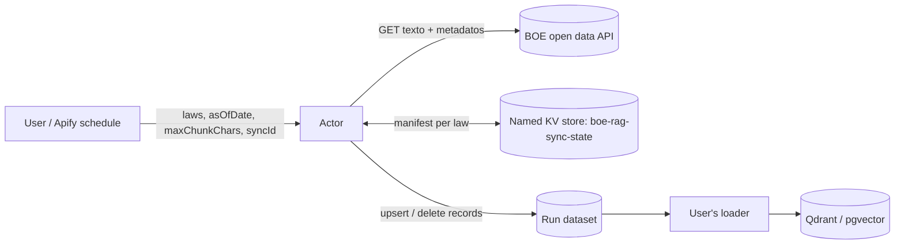

# boe-rag-sync — Design

An Apify Actor that turns Spanish consolidated legislation from the BOE into RAG-ready chunks
(one article per chunk when it fits, with its place in the law and the version in force at a date)
and keeps a vector store in sync by emitting `upsert` and `delete` records.

## Goals and non-goals

Goals:
- Chunks that respect legal structure: never cut mid-sentence when a paragraph boundary exists, always
  carry the law > title > chapter > article path.
- Correct incremental sync: the user's store never keeps an outdated or orphaned chunk.
- Zero infrastructure to operate: everything runs on Apify; no database of our own.

Non-goals (v1): case law, the daily gazette, embeddings, full-text search by law title, version history
output (`asOfDate` covers point-in-time queries).

## Source data (verified 2026-11-03)

`GET https://www.boe.es/datosabiertos/api/legislacion-consolidada/id/{id}/texto` (`Accept: application/xml`)
returns every block of a law with **all** its versions:

```xml
<bloque id="a4" tipo="precepto" titulo="Artículo 4">
  <version id_norma="BOE-A-2023-5366" fecha_publicacion="20230301" fecha_vigencia="20230302">
    <p class="articulo">Artículo 4. Derechos laborales.</p>
    <p class="parrafo">1. Los trabajadores …</p>
  </version>
</bloque>
```

Facts that shape the design:
- Hierarchy is flat: `encabezado` blocks (classes `libro_num`, `titulo_num`, `capitulo_num`, `seccion`,
  `subseccion`, plus irregular ones in the Civil Code) are siblings of the articles; the path is rebuilt
  by level.
- Block ids are not uniform across laws (`a4`, `art72`, `as127a130`); they are treated as opaque.
- Repealed articles keep a last version titled "(Suprimido)", "(Derogado)", "(Sin contenido)" or
  "(Anulado)".
- Editorial notes (`nota_pie`, `blockquote`) are noise for embeddings and are excluded from `text`.
- Two versions of a block can share `fecha_vigencia` (Workers' Statute art. 37, 2026-10-23); ties are
  broken by document order.
- The API does not say when a version was added to the consolidated text, so the state of a past run
  cannot be rebuilt from today's XML (see ADR 0002).
- Sizes: 1.4–3.7 MB per law; the income tax law has articles up to 56k characters and 86 tables.

## Architecture



Functional core, imperative shell: everything except the HTTP fetch and `main.py` is a pure function,
tested against real BOE XML fixtures.

| Module | Responsibility |
|---|---|
| `boe.py` | Fetch (httpx, retries with backoff) and parse XML into laws and blocks with hierarchy and versions |
| `chunking.py` | Pick the version in force at `asOfDate`, convert to Markdown (tables included), split, build records, ids and hashes |
| `sync.py` | `diff(manifest, current, full_reload) -> ops` |
| `main.py` | Apify shell: input, manifest I/O, `push_data`, `charge`, run summary in `OUTPUT` |
| `aliases.py` | Alias → BOE id for the most used laws |

### Splitting

Cascade: an article is one chunk; if it exceeds `maxChunkChars`, split by paragraphs; only a paragraph
that alone exceeds the limit is split by sentences. Tables are never split mid-row; an oversized table
is split by rows repeating the header.

### Sync

The manifest stores, per `(syncId, law)`, `{chunk_id: content_hash}` of what was last emitted.
Each run computes the current chunks and diffs:
- `upsert` when the id is new or its hash changed;
- `delete` when the id is in the manifest but no longer produced.

The manifest is written per law after its records are pushed. A crash between push and write re-emits
the same records next run, which is safe because every record is idempotent.
Before each article the Actor checks the user's spending limit and stops before starting an article it
cannot finish. A law that fails to fetch or parse leaves its manifest untouched; other laws continue and
the run ends with an error listing the failures. Laws removed from the input are left untouched.

## Contracts

Input: `laws` (required; BOE id, URL or alias), `asOfDate` (default: today in Europe/Madrid),
`maxChunkChars` (default 2000), `syncId` (default `"default"`), `fullReload` (default false).

Ids: `chunk_id = {law_id}:{block_id}:{i}`, `point_id = uuid5(NAMESPACE, chunk_id)` (Qdrant only accepts
unsigned integers or UUIDs). See ADR 0003 for the record schema.

## Reuse conditions of the BOE

Every record carries `attribution` ("Basado en datos de la Agencia Estatal Boletín Oficial del Estado"),
`disclaimer` (consolidated text is informative only) and `law_updated_at`. Nothing in the name or
listing suggests the BOE endorses the Actor.
